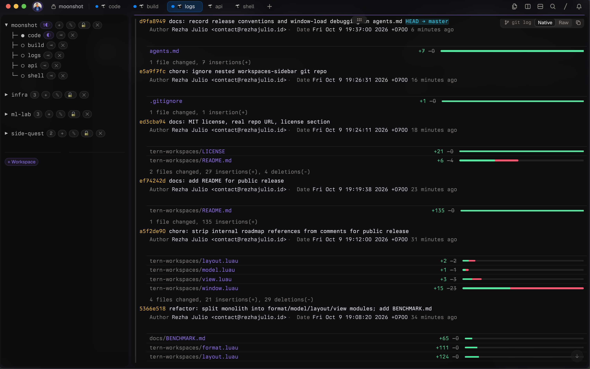

# workspaces-sidebar

A pinned workspaces sidebar for [Tern](https://stencil.so/tern), Stencil's Rust-native neoterminal. Every session is a workspace, every tab is a row in a tree, and everything that needs your attention has a badge.

If you keep several agents and long-running commands going across sessions, you know the problem. You can't see which tab is waiting on you without cycling through all of them. This plugin fixes that.



## What you get

A native canvas pane on the left of every tab. It lists your sessions as workspaces, with each session's tabs nested underneath. Each tab shows a live status badge:

| Badge | Meaning |
| --- | --- |
| ? | An agent is waiting for input |
| ◐ | A command is running |
| ! | A command failed |
| ◆ | An agent block |

Workspace headers show aggregate counts of the same badges, so you can see that something in a folded workspace needs you without opening it.

## Why sessions are workspaces

In Tern, a session is a named, persistent collection of tabs. The daemon keeps it alive when you close the window and across reboots. That is already what most people mean by "workspace", so the plugin doesn't invent a new concept. It reads your sessions and draws them as a tree. Nothing to configure, nothing to migrate.

## Features

### Navigation

Click a workspace name to switch to it. Click any tab to jump straight there. This works across workspaces, in one click, with no switch-then-pick step.

Workspaces also have keyboard jumps (Cmd+Alt+1 to 9). `Workspaces: next needing attention` (Cmd+Alt+Shift+A) goes to the first tab with a waiting agent, an alert or a failed command. If nothing needs you, it toasts "All tasks clear". I use this one more than any other binding.

The status line shows the current workspace name. Click it to toggle the sidebar.

### Keeping it tidy

Each workspace folds with its chevron. A collapsed workspace shows its tab count.

Tabs can carry color tags. Click the color badge to cycle through Tern's native tab colors: blue, green, yellow, orange, red, purple, teal, pink. Tags persist across restarts.

To move a tab to another workspace, click its ⇥ badge. Every other badge hides, and you pick "Move here" on the target (Esc cancels). Or run `Workspaces: move tab to workspace...` from the command palette to pick a target workspace via fuzzy picker. To reorder inside a workspace, shift-click a tab row to move it up, or alt-click to move it down.
### Creating and closing

The `+` on a workspace header opens a new tab in that workspace's directory. `+ Workspace` at the bottom creates a session named after your current folder and opens it there. If the name is taken, it dedups.

To rename a workspace, click the `✎` icon on its header, or run `Workspaces: rename workspace` from the palette to open an inline prompt. Renaming updates both the sidebar and status line instantly without switching your active workspace.

`✕` closes a tab or an unlocked workspace. Accidental workspace closure is prevented by locking it with the 🔒/🔓 button. When a session ends (from another window, `tern kill session`, or an `--end-on-success` block), its fold state is cleaned up and the sidebar redraws immediately.

Press Ctrl+D in a shell and the tab closes cleanly. Without this, you get an orphaned sidebar sitting alone in a dead tab. Toggleable in settings.
### Layout and focus

The sidebar mounts itself on every tab. On Tern 0.9.8+, it opens directly at your saved width using native canvas placement, without resize hops or visual flicker. Drag the divider once and every tab follows; the plugin calibrates against window width automatically.

Focus behaves. Clicking around the sidebar never leaves focus stranded on it, and switching tabs restores the terminal focus of the tab you're going to. Rapid tab switching and focus changes are debounced so you never hit frame budget limits.
Splitting panes respects the sidebar:
- **Split down (`Shift+Cmd+D`)**: When focused on the sidebar, splits downward into the empty space below the `+ Workspace` button. Perfect for pinning an agent, task manager, or log monitor under the rail.
- **Split right (`Cmd+D`)**: When focused on the sidebar, automatically redirects to the active terminal pane instead of splitting the rail into narrow, unreadable slivers.
- **Drag-and-drop**: You can drag any terminal or block into the area beneath the sidebar rail. It stays pinned there across tab polls.

Paths come in two styles: **smart** (shows folder basename, or `parent/basename` for generic directories like `src`) and **fish** (abbreviates parents to single characters like `~/W/p/tern-sidebar`). Color tag labels can be shown or hidden.
## Install

You need Tern (closed beta). From a git URL:

```sh
tern plugin install github.com/rezhajulio/workspaces-sidebar
```

Or from a local checkout:

```sh
tern plugin link .
tern plugin reload
```

## Commands and keybindings

Palette commands and keyboard shortcuts:

| Command | Binding | Description |
| --- | --- | --- |
| `Workspaces: toggle sidebar` | `Cmd+Alt+Shift+B` | Show or hide the sidebar across all tabs |
| `Workspaces: next needing attention` | `Cmd+Alt+Shift+A` | Jump to first tab with waiting agent, alert, or failed command |
| `Workspaces: next` | `Cmd+Alt+Shift+]` | Step forward to the next workspace |
| `Workspaces: previous` | `Cmd+Alt+Shift+[` | Step backward to the previous workspace |
| `Workspaces: go to 1` … `9` | `Cmd+Alt+1` … `9` | Jump directly to workspace 1 through 9 |
| `Workspaces: new` | — | Create and seed a new workspace from current directory |
| `Workspaces: rename workspace` | — | Prompt to rename the active workspace |
| `Workspaces: move tab to workspace...` | — | Pick a target workspace for the focused tab |
| `Workspaces: cycle active tab color` | — | Cycle through the 8 native tab colors on focused tab |
| `Workspaces: toggle path style (smart / fish)` | — | Switch between smart basename and fish abbreviated paths |
| `Workspaces: toggle color tags` | — | Show or hide colored dot indicators on tabs |
| `Workspaces: toggle color tag labels` | — | Show or hide textual color names |
| `Workspaces: toggle auto-close empty tabs` | — | Toggle whether Ctrl+D shell exit auto-closes the tab |
| Cancel move mode | `Esc` | Exit tab move mode |

Mouse actions on the sidebar:

| Action | Target / Gesture |
| --- | --- |
| Switch workspace | Click workspace name |
| Jump to tab | Click tab row |
| Fold / unfold workspace | Click chevron (▸ / ▾) |
| Rename workspace | Click `✎` icon |
| New tab in workspace cwd | Click `+` on workspace header |
| New workspace from current cwd | Click `+ Workspace` at bottom of rail |
| Close tab | Click `✕` on tab row |
| Close workspace | Click `✕` on workspace header (unlocked only) |
| Lock / unlock workspace | Click `🔒` / `🔓` icon |
| Cycle tab color tag | Click the color indicator circle |
| Move tab between workspaces | Click `⇥` badge, then click `Move here` on target |
| Reorder tab in workspace | `Shift`-click row to move up, `Alt`-click to move down |
| Toggle sidebar | Click the workspace name segment in the status line |
| Stack block under rail | Press `Shift+Cmd+D` or drag block under the rail |

## Toggles and settings

Settings are persisted across Tern restarts via `tern.kv`:

| Setting | Default | Description |
| --- | --- | --- |
| `path_style` | `"smart"` | Directory formatting: `"smart"` vs `"fish"` |
| `color_tags_enabled` | `true` | Show or hide color tags on tabs |
| `color_labels_enabled` | `false` | Show textual color tag labels beside glyphs |
| `auto_close_empty_tabs` | `true` | Auto-close orphaned tab when shell exits (Ctrl+D) |
| `pinned` | `true` | Pinned sidebar rail visibility |
| `sidebar_ratio` | dynamic | Divider width ratio, synced across tabs on drag |

## How it works, and what it can't do

Tern's Luau API has no window-level sidebar surface. So the plugin mounts one canvas pane per tab and keeps their widths in sync. It looks and feels like one sidebar. Under the hood it is many.

Updates are event-driven: shell directory changes (`cwd`), command lifecycle (`command_started`/`command_finished`), agent status transitions (`agent_state`/`agent_finished`), and session teardown (`session_ended`) trigger debounced redraws within 30ms, backed by a 250ms polling loop for asynchronous state.

Some things are stashed until Tern exposes the APIs they need: session notes and filter chips.

Drag-and-drop reorder across tabs isn't possible, because canvas panes only receive clicks. That's why reordering uses modifier-click.
## Development

```sh
tern plugin link .
tern plugin reload
tern plugin list --json
```

Layout of the repo:

| File | Role |
| --- | --- |
| `plugin.toml` | Manifest |
| `window.luau` | Wiring |
| `format.luau` | Formatting helpers |
| `model.luau` | State |
| `layout.luau` | Layout |
| `view.luau` | Drawing |
| `tern.d.luau` | Types, regenerate with `tern plugin types .` |
| `check_test.py` | Manifest and action parser asserts |

## License

MIT. See [LICENSE](LICENSE).
